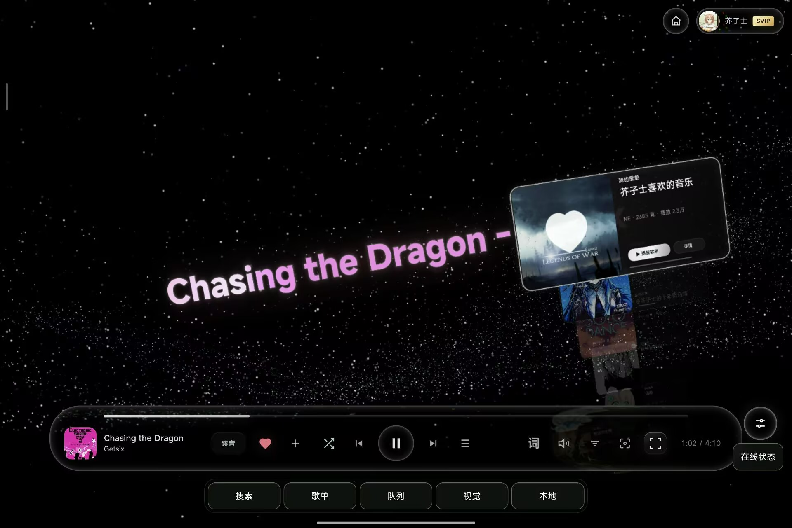

# Mineradio Android

将音乐、粒子可视化、歌词舞台与3D歌单架带到Android。在线接口已内置，安装后无需另外部署后端。

基于 [bolaosi/Mineradio-Android](https://github.com/bolaosi/Mineradio-Android)，保留 [原桌面项目](https://github.com/XxHuberrr/Mineradio-paused) 的视觉特色。



*用户提供的实际操作截图，原图保留。截图展示界面效果，不代替各项功能验收。*

## 当前版本

**1.2.3-debug · versionCode 8 · Android 7.0 / API 24及以上**

- 网易云二维码登录：获取、生成、轮询、确认、过期刷新与取消；官方账号验证通过后才显示登录。支持保存PNG，供另一台设备扫码或官方App相册识别。
- QQ音乐：隔离的官方登录窗口与验证回传（API 28+），保留本人完整Cookie导入。真实账号自动登录、歌单读取及播放权限仍需分别验证。
- 本地音乐：系统文件选择器多选导入、播放队列、暂停继续、进度拖动、前后首及移除；具有持久读授权的文件可在重启后恢复。
- 后台播放：Media3 ExoPlayer + MediaSessionService持有唯一播放器、在线/本地队列和切歌逻辑；支持通知控制、音频焦点、顺序循环、随机及单曲循环。后台下一首不依赖WebView的ended回调。
- 手机操作：稳定可见的搜索、歌单、队列、视觉和本地入口；搜索可立即播放或加入队列，不需停止当前音乐。
- 视觉：保留粒子、歌词舞台、3D歌单架、简约/DIY、视觉预设、图片/视频背景、低负载模式及设备支持时的原生EQ；显式选择保存后优先于自动样式。

### 最近修复

1. 修复频谱处理器自复制共享空缓冲导致所有歌曲报 `ERROR_CODE_FAILED_RUNTIME_CHECK` 的缺陷。
2. 补齐3D一级歌单和二级歌曲详情的手指拖动、松手、取消及点击区分；侧边上下滑动，舞台横向滑动。
3. 手机点歌保留3D详情，封面/队列重建不再强制滚回当前歌曲；DOM列表保留原生滚动并防止拖动误点击。
4. 底部五入口与“在线状态”复用同一套半透明玻璃背景、模糊、细边框和圆角，保留触摸区域与安全区。

## 使用

1. 安装APK，直接使用“本地”导入音频，或在“搜索”选择网易/QQ并搜索歌曲。
2. 网易云点“登录”获取二维码；同屏可保存PNG后尝试官方App扫一扫的相册识别，不支持时用另一台设备扫码。
3. QQ点“打开QQ官方登录”，完成官方授权后返回验证；第三方页面或风控受限时，可使用Cookie备用入口。
4. 登录、歌单可读、某首歌曲有播放权限是不同的状态。会员、版权、地区及试听限制以官方响应为准。

代码和构建工作流见本仓库。已完成本地APK构建；本次代码推送不创建GitHub Release。自动构建产物可在 [Actions](https://github.com/bolaosi/Mineradio-Android/actions/workflows/build-apk.yml) 中查看，具体是否成功以对应运行记录为准。

自行构建和CI默认使用各自的debug证书，与此前本地交付APK的签名可能不同；覆盖安装需要一致的签名。私钥不入库。

## 构建与测试

需要完整JDK 17、Android SDK Platform 34和Build Tools 34.0.0。Gradle 8.5 wrapper已包含；首次构建需下载依赖。

```sh
# Linux / macOS
./gradlew --no-daemon lintDebug testDebugUnitTest assembleDebug
```

```powershell
# Windows，先设置JAVA_HOME和ANDROID_HOME
./gradlew.bat --no-daemon lintDebug testDebugUnitTest assembleDebug
```

APK输出：`app/build/outputs/apk/debug/app-debug.apk`。

```sh
# Node测试；使用模拟接口，不要求账号或在线后端
node --test tests/*.test.cjs app/src/main/assets/nodejs-project/test/*.test.js
```

完整环境、浏览器触摸测试命令及设备验收步骤见 [BUILD_AND_VERIFY.md](BUILD_AND_VERIFY.md)，当前验证边界见 [验证记录](docs/VERIFICATION.md)。

## 验证边界

- 本地已通过62项Java/Android框架测试、49项Node测试和26段真实Chromium触摸回归；横竖屏导航、搜索、视觉设置及模拟原生状态同步通过。
- 用户此前真机确认网易扫码可用。本轮没有真实账号复验；QQ自动登录闭环、歌曲权限不能根据模拟接口认定成功。
- 3D缺少触摸链路已复现并修复。独立DOM列表在本机播放前后均能滚动，手机上“播放后卡住”的唯一根因尚未确定，需要实际WebView复验。
- 没有连接Android设备。模拟AudioTrack输出和浏览器触摸不等于手机实际出声、硬件进度或息屏连续三首通过。
- 尚未移植桌面歌词窗口、桌面更新器，以及天气广播、在线播客、歌手详情等附加接口。网易歌单单次最多补取500首，未完整载入时显示数量。

## 凭据和来源

每个安装实例在App私有目录独立保存网易/QQ凭据，备份关闭；退出登录清除相应状态。原生桥只接受 `https://mineradio.local` 主框架，不向任意网页开放文件读取或账号能力。音源按需获取，不持久化在线签名URL、不把账号凭据放入公开地址、不绕过官方验证码、风控或版权限制。

`app/src/main/assets/nodejs-project` 仅保留为协议来源和开发测试参考，整个目录不打入APK。它的远程运行方式为单用户模式，不能多人共享登录态；见 [开发后端说明](app/src/main/assets/nodejs-project/BACKEND_DEPLOYMENT.md)。

第三方代码来源与许可见 [third-party-notices.txt](app/src/main/assets/third-party-notices.txt)，保留原项目及相关依赖的许可约束。
